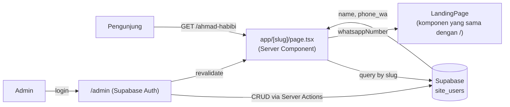
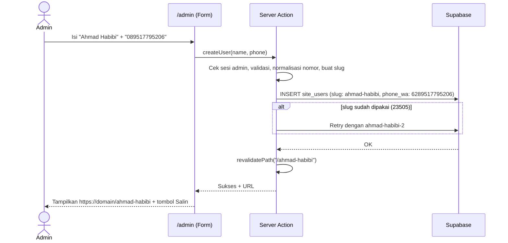
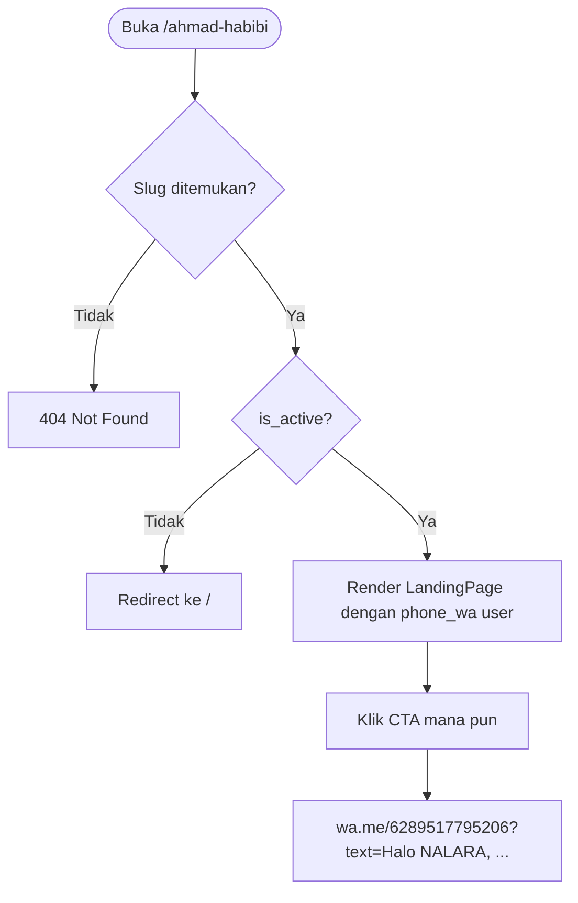

# PRD — Manajemen User & Landing Page Dinamis per Slug (NALARA)

| | |
| :--- | :--- |
| **Proyek** | NALARA — Landing Page 1 Halaman |
| **Fitur** | Admin User Management + URL personal (`/nama-user`) dengan CTA WhatsApp milik user |
| **Status** | Draft v1.0 |
| **Tech Stack** | Next.js 16 (App Router), React 19, TypeScript 5, Tailwind v4, Supabase |
| **Dokumen terkait** | `docs/document.md` (dokumentasi teknis proyek saat ini) |

---

## 1. Ringkasan

Saat ini seluruh tombol CTA di landing page NALARA mengarah ke satu nomor WhatsApp yang di-hardcode di `lib/site-config.ts`.

Fitur ini memungkinkan **admin menambahkan user hanya dengan nama dan nomor telepon**. Setiap user otomatis mendapat URL sendiri:

```
Admin input:  Ahmad Habibi — 089517795206
Hasil URL:    https://<domain>/ahmad-habibi
CTA button:   https://wa.me/6289517795206?text=...
```

**Prinsip utama:** tidak ada halaman baru untuk landing. `/ahmad-habibi`, `/budi-santoso`, dan `/` semuanya merender **komponen halaman 1 yang sama**. Yang berbeda hanya nomor tujuan semua tombol WhatsApp.

### Kelayakan teknis

Fitur ini **sangat layak** dengan Supabase. Alasannya:

- Data yang disimpan kecil (nama, slug, nomor), cukup satu tabel.
- Next.js App Router mendukung dynamic route `app/[slug]/page.tsx` yang memuat data dari Supabase di server.
- Supabase Auth + Row Level Security (RLS) mengamankan akses admin tanpa membangun sistem login sendiri.
- Dokumentasi saat ini sudah menyebut Supabase sebagai opsi (invoice/payment). Jika sudah disiapkan, project dan env var-nya bisa dipakai ulang.

---

## 2. Tujuan & Non-Tujuan

### Tujuan
1. Admin dapat membuat, melihat, mengubah, menonaktifkan, dan menghapus user lewat panel admin.
2. Setiap user aktif punya URL unik berbasis nama (slug) yang menampilkan landing page 1 dengan CTA ke nomor user tersebut.
3. Penambahan user **tidak memerlukan deploy ulang**. Data langsung berlaku setelah disimpan.
4. Halaman utama `/` tetap berfungsi seperti sekarang dengan nomor default NALARA.
5. Tidak ada regresi pada desain, performa, dan SEO halaman utama.

### Non-Tujuan (di luar scope v1)
- Login atau dashboard untuk user (hanya admin yang punya akses).
- Kustomisasi konten per user (judul, harga, portofolio, warna). Hanya nomor CTA yang berbeda.
- Pembayaran otomatis per user (Midtrans) dan pembagian komisi.
- Multi-admin dengan level role yang kompleks.
- Custom domain per user.

---

## 3. Pengguna & Peran

| Peran | Deskripsi | Akses |
| :--- | :--- | :--- |
| **Admin** | Pemilik/pengelola NALARA | Login ke `/admin`, CRUD user |
| **User (pemilik slug)** | Orang yang namanya & nomornya didaftarkan admin | Tidak login. Hanya menerima URL untuk dibagikan |
| **Pengunjung** | Calon klien yang membuka `/` atau `/slug-user` | Publik, hanya melihat landing page |

---

## 4. User Stories

| ID | Sebagai | Saya ingin | Agar |
| :--- | :--- | :--- | :--- |
| US-1 | Admin | Login dengan aman ke panel admin | Hanya saya yang bisa mengelola user |
| US-2 | Admin | Menambah user dengan input nama + nomor telepon saja | Proses cepat tanpa form panjang |
| US-3 | Admin | Melihat URL otomatis setelah user dibuat, dengan tombol salin | Bisa langsung dibagikan ke user |
| US-4 | Admin | Melihat daftar semua user (cari & urutkan) | Mudah mengelola banyak user |
| US-5 | Admin | Mengubah nama atau nomor user | Jika ada kesalahan atau nomor berganti |
| US-6 | Admin | Menonaktifkan / mengaktifkan user tanpa menghapus | Menghentikan URL sementara |
| US-7 | Admin | Menghapus user | Membersihkan data yang tidak dipakai |
| US-8 | Pengunjung | Membuka `/ahmad-habibi` dan klik CTA | Langsung chat WhatsApp ke Ahmad Habibi |
| US-9 | Pengunjung | Membuka `/` | Tetap terhubung ke nomor default NALARA |

---

## 5. Requirement Fungsional

### 5.1 Panel Admin (`/admin`)

**FR-A1 — Autentikasi**
- Halaman `/admin/login` dengan email + password (Supabase Auth).
- Semua rute `/admin/*` (kecuali login) diproteksi. Pengunjung yang belum login di-redirect ke `/admin/login`.
- Hanya akun yang terdaftar sebagai admin yang boleh masuk (lihat bagian 7.3).
- Tombol Logout.

**FR-A2 — Tambah user**
- Form dengan **2 field saja**: `Nama` dan `Nomor Telepon`.
- Saat disimpan, sistem otomatis:
  1. Membuat **slug** dari nama (`Ahmad Habibi` → `ahmad-habibi`).
  2. Menormalisasi nomor ke format WhatsApp (`089517795206` → `6289517795206`).
- Setelah sukses, tampilkan URL lengkap + tombol **Salin Link** dan **Buka Link**.
- Validasi dan pesan error dalam Bahasa Indonesia.

**FR-A3 — Daftar user**
- Tabel: Nama, URL (slug), Nomor, Status (aktif/nonaktif), Tanggal dibuat, Aksi.
- Pencarian berdasarkan nama atau nomor.
- Aksi per baris: Salin link, Buka link, Edit, Aktifkan/Nonaktifkan, Hapus (dengan dialog konfirmasi).

**FR-A4 — Edit user**
- Admin dapat mengubah nama dan nomor.
- Slug **tidak berubah otomatis** saat nama diedit, supaya link yang sudah dibagikan tidak mati. Slug dapat diedit manual lewat field terpisah dengan peringatan "link lama tidak akan berfungsi".

**FR-A5 — Nonaktifkan / Hapus**
- Nonaktif: data tetap ada, URL tidak lagi menampilkan CTA user.
- Hapus: data dihapus permanen setelah konfirmasi.

### 5.2 Landing Page Dinamis (`/[slug]`)

**FR-L1 — Resolusi slug**
- Request ke `/ahmad-habibi` mencari user dengan `slug = 'ahmad-habibi'` dan `is_active = true`.
- Jika ditemukan, render landing page 1 dengan nomor milik user.
- Jika slug **tidak ditemukan**, tampilkan 404 (`notFound()`).
- Jika user **nonaktif**, redirect ke `/` (halaman utama dengan nomor default NALARA). Bisa diubah ke 404 jika bisnis menghendaki.
- Slug bersifat case-insensitive. `/Ahmad-Habibi` di-redirect (308) ke `/ahmad-habibi`.

**FR-L2 — Semua CTA memakai nomor user**
Seluruh titik CTA WhatsApp berikut harus memakai nomor dari user (atau nomor default jika di `/`):

| Komponen | CTA yang terpengaruh |
| :--- | :--- |
| `hero.tsx` | Tombol "Konsultasi" di navigasi atas |
| `announcement.tsx` | Tautan promo (jika mengarah ke WA) |
| `solutions.tsx` | CTA WhatsApp (jika ada) |
| `client-work.tsx` | CTA banner "sistem kustom" |
| `offer.tsx` | Tombol WhatsApp tiap paket (Beginner, Starter, Business) |
| `footer.tsx` | Tautan WhatsApp resmi |
| `floating-whatsapp.tsx` | Tombol WhatsApp melayang |
| `app/checkout/page.tsx` | Redirect ke WhatsApp (lihat FR-L4) |

**FR-L3 — Isi pesan WhatsApp**
- Format pesan terisi otomatis per paket tetap sama dengan sekarang (`Halo NALARA, saya tertarik pesan Paket Starter ...`).
- Hanya **nomor tujuan** yang berubah. Lihat Open Question OQ-2 jika ingin menambah nama user di pesan.

**FR-L4 — Checkout redirect**
- `app/checkout/page.tsx` saat ini redirect ke corong WhatsApp. Agar konsisten, route ini menerima parameter `?ref=<slug>` dan mengarahkan ke nomor user terkait. Tanpa `ref`, memakai nomor default.

**FR-L5 — Elemen yang tidak berubah**
Promo timer (`localStorage`), harga, portofolio, teks, desain, dan tautan Instagram brand tetap sama di semua URL. Lihat OQ-3 untuk Instagram.

### 5.3 Halaman Utama (`/`)
- Tidak berubah secara visual. Memakai nomor default dari `siteConfig.whatsappNumber`.

---

## 6. Aturan Bisnis & Validasi

### 6.1 Normalisasi nomor telepon
Input admin boleh berformat bebas. Sistem menyimpan dua nilai: `phone_raw` (apa adanya, untuk ditampilkan) dan `phone_wa` (format `wa.me`).

| Input | `phone_wa` |
| :--- | :--- |
| `089517795206` | `6289517795206` |
| `0895-1779-5206` | `6289517795206` |
| `+62 895 1779 5206` | `6289517795206` |
| `6289517795206` | `6289517795206` |
| `8951779206` (tanpa 0) | `628951779206` (diterima, lalu dicek panjang) |

Aturan:
1. Hapus semua karakter non-digit (spasi, tanda hubung, tanda kurung, `+`).
2. Jika diawali `0` → ganti dengan `62`.
3. Jika diawali `62` → biarkan.
4. Jika diawali `8` → tambahkan `62` di depan.
5. Validasi akhir: harus diawali `628` dan panjang total **10–15 digit**. Jika tidak, tolak dengan pesan "Nomor telepon tidak valid".

Referensi implementasi:

```ts
// lib/phone.ts
export function normalizePhoneToWa(input: string): string | null {
  let n = input.replace(/\D/g, "");
  if (n.startsWith("0")) n = "62" + n.slice(1);
  else if (n.startsWith("8")) n = "62" + n;
  if (!/^628\d{7,12}$/.test(n)) return null;
  return n;
}
```

### 6.2 Pembuatan slug
1. Lowercase, hapus aksen/diakritik, ganti spasi dan karakter non-alfanumerik dengan `-`, rapikan tanda hubung ganda dan di ujung.
2. `Ahmad Habibi` → `ahmad-habibi`. `Siti N. Aisyah` → `siti-n-aisyah`.
3. **Duplikat:** jika slug sudah ada, tambahkan sufiks angka (`ahmad-habibi-2`, `-3`, dst.). Pengecekan dijamin oleh unique constraint database (tangani error `23505` dengan retry).
4. Panjang slug 3–60 karakter.
5. **Slug terlarang (reserved)** agar tidak bentrok dengan rute sistem:
   `admin`, `api`, `checkout`, `invoice`, `login`, `logout`, `robots`, `sitemap`, `_next`, `favicon`, `static`, `public`, `masalah`, `solusi`, `portofolio`, `penawaran`.

   Catatan: Next.js memprioritaskan route statis di atas `[slug]`, tetapi daftar ini tetap perlu diterapkan sebagai pengaman.

### 6.3 Aturan lain
- Nama wajib diisi, 2–80 karakter.
- Nomor yang sama **boleh** dipakai beberapa user. Tampilkan peringatan non-blokir di UI jika terdeteksi duplikat (lihat OQ-4).

---

## 7. Desain Teknis

### 7.1 Arsitektur



### 7.2 Skema Database (Supabase / PostgreSQL)

```sql
create table public.site_users (
  id          uuid primary key default gen_random_uuid(),
  name        text        not null check (char_length(name) between 2 and 80),
  slug        text        not null unique
              check (slug ~ '^[a-z0-9]+(-[a-z0-9]+)*$' and char_length(slug) between 3 and 60),
  phone_raw   text        not null,            -- input asli admin, untuk tampilan
  phone_wa    text        not null check (phone_wa ~ '^628[0-9]{7,12}$'),
  is_active   boolean     not null default true,
  created_at  timestamptz not null default now(),
  updated_at  timestamptz not null default now()
);

create index site_users_active_slug_idx on public.site_users (slug) where is_active;

-- auto-update updated_at
create or replace function public.set_updated_at() returns trigger as $$
begin new.updated_at = now(); return new; end; $$ language plpgsql;

create trigger site_users_set_updated_at
before update on public.site_users
for each row execute function public.set_updated_at();

-- daftar admin yang berhak
create table public.admins (
  user_id uuid primary key references auth.users(id) on delete cascade
);
```

### 7.3 Keamanan & RLS

```sql
alter table public.site_users enable row level security;
alter table public.admins     enable row level security;

-- Publik hanya boleh membaca user AKTIF (nomor memang tampil publik di tombol WA)
create policy "public read active users"
on public.site_users for select
to anon, authenticated
using (is_active = true);

-- Hanya admin yang boleh baca semua + tulis
create policy "admin full access"
on public.site_users for all
to authenticated
using      (exists (select 1 from public.admins a where a.user_id = auth.uid()))
with check (exists (select 1 from public.admins a where a.user_id = auth.uid()));

-- admins hanya bisa dibaca oleh dirinya sendiri; insert lewat SQL Editor / service role
create policy "read own admin row"
on public.admins for select
to authenticated
using (user_id = auth.uid());
```

Ketentuan keamanan:
- `SUPABASE_SERVICE_ROLE_KEY` **tidak boleh** diekspos ke client (tanpa prefix `NEXT_PUBLIC_`). Tidak diperlukan untuk alur utama karena RLS sudah cukup.
- Akun admin dibuat manual lewat Supabase Auth, lalu `user_id`-nya dimasukkan ke tabel `admins`. Tidak ada pendaftaran publik.
- Nonaktifkan fitur sign-up publik di pengaturan Supabase Auth.
- Semua mutasi lewat **Server Actions** dengan validasi input di server (mis. Zod). Jangan percaya validasi client saja.
- Middleware/proxy Next.js memeriksa sesi untuk `/admin/*`, dan Server Action memeriksa ulang sesi serta keanggotaan admin.
- Pertimbangkan rate limiting atau proteksi brute-force pada login (fitur bawaan Supabase Auth + opsional CAPTCHA).

### 7.4 Perubahan Kode

**File baru**

```text
app/
├── [slug]/page.tsx              # Landing dinamis: ambil user by slug → render <LandingPage />
├── admin/
│   ├── layout.tsx               # Guard sesi admin
│   ├── login/page.tsx           # Form login
│   ├── page.tsx                 # Daftar user + aksi
│   └── actions.ts               # Server Actions: createUser, updateUser, toggleUser, deleteUser
components/
├── landing-page.tsx             # Seluruh isi halaman 1 (dipindah dari app/page.tsx), menerima props
├── contact-provider.tsx         # React Context: whatsappNumber + helper buildWaUrl
└── admin/                       # Form, tabel, dialog konfirmasi, tombol salin link
lib/
├── supabase/
│   ├── server.ts                # Client server (@supabase/ssr)
│   └── client.ts                # Client browser (untuk login)
├── phone.ts                     # normalizePhoneToWa()
├── slug.ts                      # slugify(), daftar reserved slug
└── site-users.ts                # getActiveUserBySlug(), listUsers() ...
```

**File yang dimodifikasi**

| File | Perubahan |
| :--- | :--- |
| `app/page.tsx` | Hanya merender `<LandingPage whatsappNumber={siteConfig.whatsappNumber} />` |
| `lib/site-config.ts` | Fungsi pembuat link WA menerima parameter nomor: `getWhatsAppUrl(number, message)`. Nomor default tetap ada sebagai fallback |
| `components/sections/*` & `floating-whatsapp.tsx` | Mengambil nomor dari `useContact()` (Context) alih-alih membaca konstanta global |
| `app/checkout/page.tsx` | Membaca `?ref=slug`, memetakan ke nomor user, lalu redirect |
| `app/sitemap.ts` | Tidak memasukkan URL user (lihat 7.6) |

**Pola komponen (ringkas)**

```tsx
// app/[slug]/page.tsx
export default async function UserLandingPage({ params }: { params: Promise<{ slug: string }> }) {
  const { slug } = await params;
  const user = await getActiveUserBySlug(slug.toLowerCase());

  if (!user) {
    // slug ada tapi nonaktif → redirect("/"); slug tidak ada → notFound()
  }
  return <LandingPage whatsappNumber={user.phone_wa} />;
}
```

```tsx
// components/contact-provider.tsx  ("use client")
// Menyediakan { whatsappNumber } dan buildWaUrl(message) ke semua section.
```

Memakai Context dipilih karena banyak komponen section (termasuk client component seperti `ClientWork` dan `FloatingWhatsApp`) membutuhkan nomor yang sama, sehingga tidak perlu *prop drilling* di setiap seksi.

### 7.5 Caching & Performa
- Landing page dinamis harus tetap secepat `/`. Query hanya satu baris dengan index pada `slug`.
- Gunakan caching/ISR dengan **revalidasi on-demand**: setelah admin membuat/mengubah/menghapus user, Server Action memanggil `revalidatePath('/<slug>')` (atau `revalidateTag`). Detail API menyesuaikan model caching Next.js 16 yang dipakai project.
- Target: LCP halaman user setara halaman `/` (selisih tidak signifikan).

### 7.6 SEO
- Halaman `/[slug]` berisi konten identik dengan `/`, sehingga berisiko dianggap duplikat oleh Google. Karena itu:
  - Tambahkan `robots: { index: false, follow: true }` pada metadata `/[slug]`.
  - Set `alternates.canonical` ke URL halaman utama `/`.
  - Jangan masukkan URL user ke `sitemap.ts`.
- Open Graph (judul, gambar) tetap sama dengan halaman utama agar preview saat dibagikan ke WhatsApp/sosmed konsisten.
- Opsional: `generateMetadata` boleh memakai nama user pada `title` (mis. "NALARA — via Ahmad Habibi"), lihat OQ-2.

### 7.7 Environment Variables

```env
NEXT_PUBLIC_SUPABASE_URL=...
NEXT_PUBLIC_SUPABASE_ANON_KEY=...
# Opsional, hanya server-side, jika dibutuhkan tugas admin tertentu:
SUPABASE_SERVICE_ROLE_KEY=...
```

Dependensi baru: `@supabase/supabase-js`, `@supabase/ssr`, `zod` (validasi).

---

## 8. Alur Utama

### 8.1 Admin menambah user



### 8.2 Pengunjung membuka URL user



---

## 9. Kriteria Penerimaan (Acceptance Criteria)

**Admin**
- [ ] AC-1: Akses ke `/admin` tanpa login selalu diarahkan ke `/admin/login`.
- [ ] AC-2: Akun login yang tidak ada di tabel `admins` tidak dapat membaca/mengubah data user (ditolak oleh RLS).
- [ ] AC-3: Menambah "Ahmad Habibi — 089517795206" menghasilkan slug `ahmad-habibi`, `phone_wa = 6289517795206`, dan URL tampil di UI.
- [ ] AC-4: Menambah nama yang sama kedua kali menghasilkan `ahmad-habibi-2` tanpa error.
- [ ] AC-5: Nomor tidak valid (mis. `123`) ditolak dengan pesan jelas dan tidak tersimpan.
- [ ] AC-6: Nama yang menghasilkan slug terlarang (mis. "Admin") otomatis diberi sufiks atau ditolak dengan pesan jelas.
- [ ] AC-7: Edit nama tidak mengubah slug secara otomatis.
- [ ] AC-8: Nonaktifkan, aktifkan, dan hapus berfungsi dan langsung tercermin di URL publik.

**Landing**
- [ ] AC-9: `/ahmad-habibi` menampilkan landing page identik dengan `/` (tampilan, urutan seksi, harga, promo timer).
- [ ] AC-10: **Semua** tombol WhatsApp di `/ahmad-habibi` (hero, paket Beginner/Starter/Business, banner portofolio, footer, floating) mengarah ke `wa.me/6289517795206`.
- [ ] AC-11: Pesan pre-filled per paket tetap benar dan terkirim ke nomor user.
- [ ] AC-12: `/` tetap memakai nomor default NALARA dan tidak berubah.
- [ ] AC-13: Slug tidak dikenal → 404. User nonaktif → redirect ke `/`.
- [ ] AC-14: `/Ahmad-Habibi` di-redirect ke `/ahmad-habibi`.
- [ ] AC-15: Rute sistem (`/checkout`, `/invoice/[token]`, `/api/*`, `/admin`) tetap berfungsi dan tidak tertangkap oleh `[slug]`.
- [ ] AC-16: Halaman user memiliki `noindex` dan canonical ke `/`, serta tidak ada di sitemap.
- [ ] AC-17: Perubahan data admin tampil di halaman publik dalam waktu wajar (≤ 1 menit atau segera lewat revalidasi).
- [ ] AC-18: `npm run typecheck`, `npm run lint`, dan `npm run build` lolos.

---

## 10. Rencana Pengujian

**Unit test**
- `normalizePhoneToWa`: format `08…`, `+62…`, `62…`, `8…`, spasi/tanda hubung, dan input tidak valid.
- `slugify`: spasi ganda, aksen, simbol, angka, nama panjang, dan slug terlarang.

**Integrasi / manual**
- Uji RLS di Supabase: anon bisa membaca user aktif saja, anon tidak bisa insert/update/delete, user login non-admin tidak bisa menulis, admin bisa semua.
- Uji tiap CTA di `/` dan `/slug` dengan mengklik dan memverifikasi URL tujuan.
- Uji di mobile (iOS Safari, Android Chrome) khususnya tombol floating dan deep link `wa.me`.
- Uji regresi rute: `/checkout`, `/invoice/xxx`, `/robots.txt`, `/sitemap.xml`.

---

## 11. Rencana Implementasi (Milestone)

| Fase | Pekerjaan | Estimasi |
| :--- | :--- | :--- |
| **1. Fondasi** | Setup Supabase client, env, skema SQL + RLS, buat akun admin pertama | 0,5 hari |
| **2. Refactor landing** | Pindahkan isi `app/page.tsx` ke `LandingPage`, buat `ContactProvider`, ubah semua section & helper WA agar menerima nomor dinamis. Pastikan `/` tidak berubah | 1 hari |
| **3. Route dinamis** | `app/[slug]/page.tsx`, query slug, 404/redirect, metadata `noindex`/canonical, ref di `checkout` | 0,5 hari |
| **4. Panel admin** | Login, guard sesi, daftar user, form tambah, edit, toggle, hapus, salin link, validasi & normalisasi | 1,5 hari |
| **5. Caching & QA** | Revalidasi on-demand, pengujian RLS & CTA, uji mobile, perbaikan | 0,5–1 hari |
| **Total** | | **± 4–4,5 hari kerja** |

---

## 12. Risiko & Mitigasi

| Risiko | Dampak | Mitigasi |
| :--- | :--- | :--- |
| Slug bentrok dengan rute sistem | Halaman sistem tidak bisa diakses | Daftar reserved slug + prioritas route statis Next.js |
| Duplicate content di Google | Peringkat SEO halaman utama turun | `noindex` + canonical ke `/` + tidak masuk sitemap |
| Admin salah input nomor | Lead masuk ke nomor salah | Normalisasi + validasi ketat, tampilkan pratinjau link WhatsApp di form, fitur edit |
| Akses admin bocor | Data/nomor dimanipulasi | RLS ketat, tabel `admins`, sign-up publik dimatikan, validasi di server, password kuat |
| Slug diubah → link lama mati | Link yang sudah dibagikan tidak berfungsi | Slug tidak otomatis berubah saat edit nama, beri peringatan jika diedit manual |
| Halaman dinamis lebih lambat | Konversi turun | Index `slug`, caching + revalidasi on-demand, pantau LCP |
| Ketergantungan pada Supabase (downtime) | Halaman user error | Tangani error dengan fallback aman (redirect ke `/` dengan nomor default) |

---

## 13. Metrik Keberhasilan

- Admin dapat menambah user dan mendapatkan URL **< 30 detik**.
- **100%** CTA di halaman user mengarah ke nomor yang benar (diverifikasi pada QA).
- Tidak ada penurunan skor Lighthouse performa halaman `/` dibandingkan sebelum fitur ini.
- Nol insiden akses tulis tidak sah ke tabel `site_users`.

---

## 14. Pengembangan Lanjutan (Fase 2, opsional)

- **Pelacakan klik CTA per user** (tabel `cta_clicks`) — *Telah diimplementasikan pada Fase 6A*:
  - **Tabel `cta_clicks`**: `id` (UUID PK), `user_id` (FK nullable ke `site_users`), `slug`, `cta_location`, `package`, `created_at`.
  - **Check constraint lokasi CTA**: `hero`, `offer-beginner`, `offer-starter`, `offer-business`, `floating`, `footer`, `portfolio-banner`.
  - **RLS**: Publik (`anon`/`authenticated`) INSERT saja, admin SELECT saja.
  - **Pengiriman**: `navigator.sendBeacon` dengan fallback `fetch(keepalive: true)`. Non-blocking & silent failure.
  - **Privasi**: Tidak menyimpan IP atau identitas pengunjung. In-memory sliding window rate limiting (60/menit) & dedupe.
  - **Panel Admin**: Kolom tabel "Klik (7h / Total)" dan 3 kartu metrik ringkasan lead.
- Parameter `?ref=slug` yang menyimpan atribusi saat pengunjung berpindah ke `/checkout` atau invoice.
- Import user massal via CSV.
- Kustomisasi ringan per user (foto, nama tampil di hero, teks sapaan).
- QR code otomatis untuk URL tiap user.
- Multi-admin dengan role (owner/editor).
- Log audit perubahan data user.

---

## 15. Open Questions (Perlu Keputusan)

| ID | Pertanyaan | Rekomendasi default |
| :--- | :--- | :--- |
| OQ-1 | Jika user dinonaktifkan, URL-nya redirect ke `/` atau tampil 404? | Redirect ke `/` |
| OQ-2 | Teks pesan WhatsApp tetap "Halo NALARA…" atau ditambah nama user (mis. "Referensi: Ahmad Habibi")? | Teks tetap sama (sesuai permintaan awal) |
| OQ-3 | Tautan Instagram di hero/footer tetap milik brand NALARA di semua URL? | Ya, tetap milik NALARA |
| OQ-4 | Bolehkah satu nomor dipakai lebih dari satu user? | Boleh, dengan peringatan non-blokir |
| OQ-5 | Apakah user yang sudah dihapus/ubah slug perlu redirect dari URL lama? | Tidak untuk v1 |
| OQ-6 | Perlu lebih dari satu admin sejak awal? | Cukup 1–2 admin lewat tabel `admins` |
| OQ-7 | Apakah project Supabase untuk invoice/payment sudah ada dan akan dipakai bersama? | Pakai project yang sama jika sudah ada |

---

## 16. Ringkasan Asumsi

1. "User" yang dimaksud adalah pemilik slug (mis. mitra/agen/pemasar) yang membagikan link personalnya, bukan pengunjung yang login.
2. Konten, desain, harga, dan portofolio sama persis di semua URL. Hanya nomor CTA WhatsApp yang berbeda.
3. Semua nomor adalah nomor WhatsApp Indonesia (+62).
4. Admin hanya sedikit (1–2 orang) dan dibuat manual.
5. Deployment tetap di Vercel/VPS dengan Next.js 16 seperti sekarang.