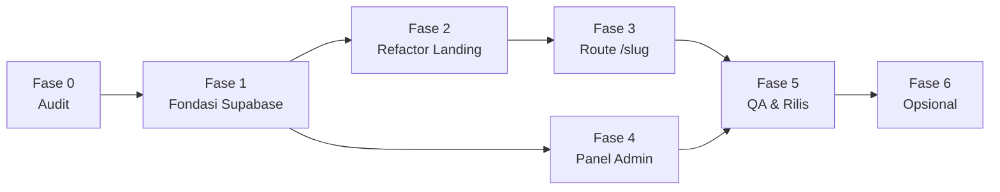

# Roadmap Eksekusi — Manajemen User & Landing Page Dinamis (NALARA)

Dokumen ini adalah panduan bertahap untuk mengeksekusi `prd.md` pada project NALARA yang sudah berjalan. Setiap fase berisi **tujuan, langkah manual dari Anda, prompt siap pakai untuk agent coding** (Claude Code, Cursor, atau sejenisnya), dan **checklist verifikasi**.

---

## Cara Memakai Dokumen Ini

1. Letakkan `prd.md` dan `roadmap.md` di folder `docs/` project (sejajar dengan `document.md`).
2. Mulai agent baru atau sesi baru, lalu tempel **Prompt Master (bagian 1)** sekali di awal. Ini memberi konteks tetap untuk seluruh pekerjaan.
3. Jalankan fase **berurutan**: Fase 0 → 1 → 2 → 3 → 4 → 5. Tempel satu prompt fase per sesi atau per giliran, jangan digabung.
4. Setelah agent selesai, **verifikasi dulu dengan checklist fase** sebelum lanjut. Jangan lanjut jika ada yang gagal.
5. Satu fase = satu branch git = satu Pull Request (atau satu commit besar yang bisa di-revert).
6. Jika agent bertanya atau berhenti karena ambigu, jawab dulu. Jangan paksa lanjut.

### Ringkasan Fase

| Fase | Nama | Output utama | Risiko ke produksi | Estimasi |
| :--- | :--- | :--- | :--- | :--- |
| 0 | Audit & Persiapan | Laporan audit repo, branch kerja | Tidak ada (read-only) | 0,25 hari |
| 1 | Fondasi Supabase | Migrasi SQL, client Supabase, util phone/slug + unit test | Rendah | 0,5 hari |
| 2 | Refactor Landing | `LandingPage` + `ContactProvider`, nomor jadi dinamis | **Sedang**, menyentuh semua section | 1 hari |
| 3 | Route Dinamis `/[slug]` | Halaman per user, 404/redirect, SEO, `checkout?ref` | Sedang | 0,5 hari |
| 4 | Panel Admin | Login + CRUD user di `/admin` | Sedang | 1,5 hari |
| 5 | Caching, QA & Rilis | Revalidasi, uji lengkap, checklist deploy | Rendah | 0,5–1 hari |
| 6 | (Opsional) Fase 2 | Tracking klik per user, QR, dll. | Rendah | Terpisah |



> Fase 4 hanya bergantung pada Fase 1, jadi bisa dikerjakan paralel dengan Fase 2–3 jika ada dua agent atau dua orang. Untuk satu agent, tetap ikuti urutan di atas.

### Keputusan Default (dari Open Questions di PRD)

Agent akan memakai keputusan ini kecuali Anda mengubahnya di Prompt Master:

| ID | Keputusan |
| :--- | :--- |
| OQ-1 | User nonaktif → redirect ke `/` |
| OQ-2 | Teks pesan WhatsApp tidak diubah (tetap "Halo NALARA…") |
| OQ-3 | Instagram tetap milik NALARA di semua URL |
| OQ-4 | Satu nomor boleh dipakai banyak user, tampilkan peringatan non-blokir |
| OQ-5 | Tidak ada redirect dari slug lama |
| OQ-6 | 1–2 admin, dibuat manual lewat tabel `admins` |
| OQ-7 | Pakai project Supabase yang sama jika sudah ada |

---

## 1. Prompt Master (tempel sekali di awal setiap sesi baru)

````text
Kamu adalah engineer senior yang melanjutkan project NALARA yang SUDAH BERJALAN di produksi: landing page 1 halaman berbasis Next.js 16 (App Router), React 19, TypeScript 5, Tailwind CSS v4, Lucide React.

TUJUAN BESAR
Menambah fitur manajemen user untuk admin. Admin menambah user hanya dengan nama + nomor telepon (contoh: "Ahmad Habibi - 089517795206"). Setiap user otomatis mendapat URL /ahmad-habibi yang menampilkan landing page 1 yang SAMA PERSIS dengan "/", tetapi semua tombol CTA WhatsApp mengarah ke nomor user tersebut (6289517795206). Tidak ada halaman landing baru: hanya satu komponen halaman dengan nomor CTA yang berbeda. Data disimpan di Supabase.

DOKUMEN ACUAN (baca dulu sebelum bekerja)
- docs/prd.md       -> requirement lengkap, skema DB, RLS, acceptance criteria
- docs/roadmap.md   -> tahapan kerja
- docs/document.md  -> dokumentasi teknis project saat ini (struktur file, komponen, alur)
Jika ada konflik antara dokumen dan kode aktual, KODE AKTUAL yang benar. Laporkan konfliknya.

ATURAN MUTLAK
1. Jangan mengubah tampilan, teks, harga, urutan seksi, atau perilaku halaman "/" . Hasil render "/" sebelum dan sesudah perubahan harus identik.
2. Jangan menyentuh logika pembayaran/invoice (app/invoice, app/api/payments, Midtrans) kecuali diminta eksplisit di prompt fase.
3. Jangan pernah menaruh secret di kode atau commit. SUPABASE_SERVICE_ROLE_KEY tidak boleh memakai prefix NEXT_PUBLIC_ dan tidak boleh sampai ke client bundle.
4. Jangan menjalankan perintah destruktif (hapus data, force push, drop table, reset database) tanpa persetujuan eksplisit dariku.
5. Kamu tidak punya akses ke dashboard Supabase-ku. Untuk perubahan database, tulis file migrasi SQL di supabase/migrations/ dan beri tahu aku langkah manual untuk menjalankannya. Jangan mengarang bahwa migrasi sudah dijalankan.
6. Next.js 16 punya perbedaan dari versi lama (mis. params/searchParams bersifat async, perubahan konvensi middleware -> proxy, model caching). Jangan mengandalkan ingatan: cek dokumentasi resmi atau docs yang ter-bundle di node_modules/next sebelum memakai API routing, caching, atau proxy/middleware.
7. Pertahankan gaya kode yang ada (penamaan file kebab-case, komponen di components/, util di lib/, Tailwind v4 utility classes, ikon Lucide). Jangan menambah dependensi di luar yang disebut di prompt fase tanpa menjelaskan alasannya dan meminta persetujuan.
8. Semua teks UI untuk admin dan pesan error dalam Bahasa Indonesia.
9. Kerjakan HANYA fase yang diminta. Jangan "sekalian" mengerjakan fase berikutnya.
10. Jika ada ambiguitas yang memengaruhi keputusan arsitektur atau data, BERHENTI dan tanyakan. Jangan menebak.

KEPUTUSAN PRODUK (default)
- User nonaktif -> redirect ke "/".  Slug tidak ditemukan -> 404.
- Teks pesan WhatsApp per paket TIDAK diubah; hanya nomor tujuan yang berubah.
- Instagram dan identitas brand tetap NALARA di semua URL.
- Halaman /[slug] memakai robots noindex, canonical ke "/", dan tidak masuk sitemap.

CARA MELAPOR DI AKHIR SETIAP FASE
Berikan: (a) ringkasan apa yang diubah per file, (b) hasil perintah verifikasi (npm run typecheck, npm run lint, npm run build, plus test jika ada) dengan output ringkas, (c) langkah manual yang harus kulakukan, (d) risiko/hal yang belum selesai, (e) saran commit message. Jangan menyatakan "selesai" jika ada perintah verifikasi yang gagal.

Balas hanya dengan "Siap" dan ringkasan 3 baris pemahamanmu tentang tugas ini. Jangan mulai coding sampai aku memberi prompt fase.
````

---

## Fase 0 — Audit & Persiapan

**Tujuan:** memastikan agent memahami kode aktual (nama file dan komponen di dokumentasi bisa saja sudah berubah) dan menemukan semua titik hardcode nomor WhatsApp **sebelum** ada perubahan.

**Langkah manual Anda (sebelum prompt):**
- [ ] Pastikan project berjalan: `npm install && npm run build` sukses.
- [ ] Commit/stash semua perubahan yang belum tersimpan.
- [ ] Buat branch: `git checkout -b feat/user-pages`.
- [ ] Copy `prd.md` dan `roadmap.md` ke `docs/`.
- [ ] Catat apakah project Supabase sudah ada (URL + anon key tersedia atau belum).

**Prompt:**

````text
FASE 0 — AUDIT (READ-ONLY, JANGAN MENGUBAH FILE APA PUN KECUALI MEMBUAT docs/audit.md)

Baca docs/prd.md, docs/roadmap.md, docs/document.md, lalu telusuri kode aktual. Hasilkan docs/audit.md berisi:

1. Versi aktual dari next, react, typescript, tailwindcss, lucide-react, dan dependensi Supabase/Midtrans jika ada (dari package.json). Daftar script npm yang tersedia.
2. Semua tempat yang membaca nomor WhatsApp atau membuat link wa.me. Cari: siteConfig.whatsappNumber, wa.me, whatsapp, getWhatsApp, href yang mengandung "wa.me". Untuk setiap temuan tulis: path file, nomor baris, apakah file itu Server atau Client Component, dan bagaimana link dibentuk.
3. Struktur app/page.tsx saat ini: urutan komponen yang dirender, props yang dipakai, apakah ada logic selain komposisi.
4. Isi app/checkout/page.tsx dan bagaimana ia redirect ke WhatsApp.
5. Isi app/layout.tsx (metadata, canonical), app/sitemap.ts, app/robots.ts.
6. Status Supabase: apakah sudah ada paket @supabase/*, folder supabase/, env var terkait, atau kode yang memakainya (mis. di app/api/payments).
7. Apakah ada test runner (vitest/jest) dan konfigurasi lint/typecheck.
8. Daftar rute yang sudah ada di app/ (agar tahu slug apa yang harus dicadangkan).
9. Tuliskan RISIKO dan KONFLIK antara dokumentasi dan kode aktual, serta pertanyaan yang perlu kujawab sebelum Fase 1.

Di akhir, jalankan npm run typecheck, npm run lint, dan npm run build, lalu laporkan hasilnya sebagai baseline (apakah sudah bersih sebelum perubahan apa pun).
````

**Checklist verifikasi:**
- [ ] `docs/audit.md` ada dan daftar titik nomor WhatsApp lengkap (cocokkan dengan tabel FR-L2 di PRD).
- [ ] Baseline typecheck/lint/build tercatat. Jika sudah gagal sebelum perubahan, perbaiki atau catat dulu.
- [ ] Semua pertanyaan agent sudah Anda jawab.

---

## Fase 1 — Fondasi Supabase & Utilitas Inti

**Tujuan:** menyiapkan database, koneksi Supabase, serta logika murni (normalisasi nomor, pembuatan slug) yang teruji. Belum ada perubahan tampilan.

**Langkah manual Anda (setelah agent selesai):**
- [ ] Buka Supabase → **SQL Editor** → jalankan file migrasi yang dibuat agent.
- [ ] Supabase → Authentication → Providers/Settings: **matikan sign-up publik** (Disable new user signups).
- [ ] Supabase → Authentication → Users → **Add user** (email + password kuat) untuk admin.
- [ ] Jalankan di SQL Editor (ganti UUID dengan ID user admin tadi):
  `insert into public.admins (user_id) values ('UUID-ADMIN');`
- [ ] Isi `.env.local` dengan `NEXT_PUBLIC_SUPABASE_URL` dan `NEXT_PUBLIC_SUPABASE_ANON_KEY` (Project Settings → API).

**Prompt:**

````text
FASE 1 — FONDASI SUPABASE & UTILITAS INTI

Konteks: baca docs/prd.md bagian 6 (aturan bisnis) dan bagian 7.2–7.4 (skema, RLS, struktur file). Gunakan docs/audit.md sebagai referensi kondisi kode.

TUGAS
1. Dependensi: tambahkan @supabase/supabase-js, @supabase/ssr, dan zod (cek dulu apakah sudah ada; jangan duplikasi). Jika belum ada test runner, tambahkan Vitest secara minimal beserta script "test" di package.json; jika sudah ada, pakai yang ada.

2. Migrasi SQL: buat supabase/migrations/<timestamp>_site_users.sql yang berisi persis skema di PRD 7.2 (tabel site_users, trigger updated_at, index parsial, tabel admins) dan RLS di PRD 7.3. Migrasi harus idempoten sejauh memungkinkan (gunakan "if not exists" / "create or replace" bila aman) dan berisi komentar penjelasan singkat. Sertakan di komentar atas file instruksi bahwa file ini dijalankan MANUAL di Supabase SQL Editor.

3. Client Supabase:
   - lib/supabase/server.ts: client untuk Server Components/Server Actions memakai @supabase/ssr dengan cookies Next.js 16 (perhatikan API cookies() yang async; cek dokumentasi).
   - lib/supabase/client.ts: client browser (untuk login).
   - Baca env NEXT_PUBLIC_SUPABASE_URL dan NEXT_PUBLIC_SUPABASE_ANON_KEY. Buat helper yang melempar error jelas jika env belum diisi. Jangan memakai SERVICE ROLE KEY di fase ini.
   - Buat/ubah .env.example berisi nama variabel tanpa nilai. Pastikan .env.local ada di .gitignore.

4. lib/phone.ts: ekspor normalizePhoneToWa(input: string): string | null sesuai PRD 6.1 (hapus non-digit; awalan 0 -> 62; awalan 8 -> 62 + n; awalan 62 dibiarkan; valid jika /^628\d{7,12}$/). Ekspor juga formatPhoneDisplay(phoneWa) untuk tampilan, mis. "+62 895-1779-5206".

5. lib/slug.ts: ekspor slugify(name: string): string (lowercase, hapus diakritik via normalize("NFKD"), non-alfanumerik jadi "-", rapikan "-" ganda/ujung, batasi 60 karakter) dan RESERVED_SLUGS. Isi RESERVED_SLUGS dari daftar di PRD 6.2 DITAMBAH semua nama folder/rute yang kamu temukan di app/ (lihat docs/audit.md). Ekspor juga isReservedSlug(slug).

6. lib/site-users.ts (hanya fungsi baca untuk sekarang):
   - type SiteUser sesuai kolom tabel.
   - getActiveUserBySlug(slug: string): mengembalikan { name, slug, phone_wa } atau null, memakai client server. Query harus memakai kolom eksplisit, bukan select("*").
   Fungsi tulis (create/update/delete) dikerjakan di Fase 4, jangan dibuat sekarang.

7. Unit test (vitest) untuk phone.ts dan slug.ts. Wajib mencakup kasus: "089517795206", "0895-1779-5206", "+62 895 1779 5206", "6289517795206", "8951779206" -> semua menghasilkan nomor yang benar; "123", "", "abc", "0812" -> null. Slug: "Ahmad Habibi" -> "ahmad-habibi"; "  Siti  N. Aisyah " -> "siti-n-aisyah"; "Zoë Müller" -> "zoe-muller"; "Admin" -> reserved; nama berisi simbol saja -> string kosong (dan pastikan pemanggil nanti bisa menolaknya).

BATASAN
- Jangan mengubah file apa pun di app/ dan components/ pada fase ini.
- Jangan menjalankan atau mengklaim sudah menjalankan migrasi.

VERIFIKASI
Jalankan npm run test, npm run typecheck, npm run lint, npm run build. Lalu beri aku daftar langkah manual Supabase (jalankan SQL, matikan sign-up, buat user admin, insert ke admins, isi .env.local) dalam urutan yang jelas.
````

**Checklist verifikasi:**
- [ ] Semua test lulus; build bersih.
- [ ] Halaman `/` terlihat sama persis (tidak ada perubahan di `app/` dan `components/`).
- [ ] Migrasi sudah dijalankan manual dan tabel `site_users` + `admins` ada di Supabase.
- [ ] Uji RLS cepat lewat SQL Editor/Table Editor: baris `is_active=false` tidak terbaca oleh anon (bisa dites nanti di Fase 3/5).
- [ ] `.env.local` tidak ikut ter-commit.

---

## Fase 2 — Refactor Landing agar Nomor WhatsApp Dinamis

**Tujuan:** memisahkan isi halaman 1 menjadi komponen `LandingPage` yang menerima nomor WhatsApp, tanpa mengubah tampilan `/`. Ini fase paling sensitif, jadi dikerjakan sebelum route dinamis.

**Prompt:**

````text
FASE 2 — REFACTOR LANDING: NOMOR WHATSAPP DINAMIS (TANPA PERUBAHAN VISUAL)

Konteks: baca docs/prd.md bagian 5.2 (FR-L2, FR-L3, FR-L5) dan 7.4, serta docs/audit.md bagian daftar titik nomor WhatsApp. Satu-satunya tujuan fase ini: semua CTA WhatsApp mengambil nomor dari satu sumber yang bisa diganti per halaman, sementara "/" tetap memakai nomor default dan tampil identik.

TUGAS
1. lib/site-config.ts:
   - Tambahkan/ubah helper menjadi getWhatsAppUrl(number: string, message?: string) yang membuat https://wa.me/<number>?text=<encodeURIComponent(message)>.
   - Pertahankan semua helper pesan yang sudah ada (pesan konsultasi umum, Starter, Business, dst.) dan isi teksnya TIDAK BOLEH berubah satu karakter pun.
   - siteConfig.whatsappNumber tetap ada sebagai nomor default. Untuk kompatibilitas, helper lama boleh tetap diekspor dan memanggil helper baru dengan nomor default, agar tidak ada pemanggil yang rusak.

2. components/contact-provider.tsx ("use client"):
   - React Context berisi { whatsappNumber: string }.
   - Ekspor <ContactProvider whatsappNumber={...}> dan hook useContact() yang melempar error jelas jika dipakai di luar provider.
   - Ekspor helper hook useWhatsAppUrl() yang mengembalikan fungsi (message?: string) => string memakai nomor dari context.

3. components/landing-page.tsx:
   - Pindahkan komposisi seksi dari app/page.tsx ke komponen LandingPage({ whatsappNumber }) yang membungkus seluruh seksi dengan <ContactProvider>. Urutan dan struktur DOM harus sama dengan sebelumnya (termasuk FloatingWhatsApp, Announcement, dst.).
   - Jika Anda menemukan bahwa suatu seksi adalah Server Component dan perlu nomor, pilih pendekatan paling sederhana yang benar (mis. ubah menjadi Client Component hanya bila memang perlu, atau oper sebagai prop). Jelaskan pilihanmu per seksi di laporan akhir.

4. Ubah SEMUA titik CTA yang ada di docs/audit.md (hero, announcement, solutions, client-work, offer, footer, floating-whatsapp, dan lainnya yang kamu temukan) agar memakai nomor dari context/prop, bukan konstanta global. Jangan mengubah className, markup, atau teks.

5. app/page.tsx: ubah menjadi pemanggil tipis: <LandingPage whatsappNumber={siteConfig.whatsappNumber} />. Pertahankan export metadata/lainnya yang sudah ada.

6. Pastikan promo timer (localStorage) dan komponen interaktif lain (filter portofolio) tetap berfungsi dan tidak ada hydration mismatch baru.

BATASAN
- Belum ada route [slug], belum ada akses Supabase di fase ini.
- Jangan mengubah desain, copywriting, harga, atau data di lib/commerce.ts dan lib/portfolio-data.ts.

VERIFIKASI
1. Jalankan npm run typecheck, npm run lint, npm run build.
2. Buktikan tidak ada regresi: jalankan grep untuk memastikan tidak ada lagi pembacaan langsung siteConfig.whatsappNumber atau string "wa.me" di components/ selain di helper yang disetujui. Tampilkan hasil grep.
3. Buat daftar semua link wa.me yang dihasilkan di "/" (hero, tiap paket, banner portofolio, footer, floating) beserta URL final-nya, dan pastikan sama dengan sebelum refactor.
4. Jelaskan cara aku menguji manual di npm run dev.
````

**Checklist verifikasi:**
- [ ] `npm run dev` → buka `/`, bandingkan dengan produksi: tampilan identik di desktop dan mobile.
- [ ] Klik semua tombol WhatsApp: nomor dan isi pesan sama persis seperti sebelum refactor.
- [ ] Promo timer dan filter portofolio masih berjalan; tidak ada error hydration di console.
- [ ] Tidak ada nomor hardcode tersisa di `components/` (hasil grep bersih).

---

## Fase 3 — Route Dinamis `/[slug]`

**Tujuan:** mengaktifkan URL personal. Pada akhir fase ini, user yang dimasukkan **manual lewat Supabase Table Editor** sudah bisa diakses lewat `/slug`. Panel admin dibuat di Fase 4.

**Langkah manual Anda (untuk uji):**
- [ ] Di Supabase Table Editor, tambahkan 1 baris uji ke `site_users`, mis. name `Ahmad Habibi`, slug `ahmad-habibi`, phone_raw `089517795206`, phone_wa `6289517795206`, is_active `true`.
- [ ] Tambahkan 1 baris lagi dengan `is_active=false` untuk uji redirect.

**Prompt:**

````text
FASE 3 — ROUTE DINAMIS /[slug]

Konteks: baca docs/prd.md bagian 5.2 (FR-L1, FR-L4), 7.4, 7.6, dan 8.2. Fase 1 (util + Supabase) dan Fase 2 (LandingPage + ContactProvider) sudah selesai.

TUGAS
1. app/[slug]/page.tsx (Server Component):
   - Terima params sebagai Promise sesuai konvensi Next.js 16 (cek docs).
   - Normalisasi slug ke lowercase. Jika slug asli berbeda dengan versi lowercase, lakukan redirect permanen ke versi lowercase.
   - Jika slug termasuk RESERVED_SLUGS atau format tidak valid -> notFound() tanpa query database.
   - Ambil user lewat getActiveUserBySlug(). Ada tiga kasus sesuai keputusan di Prompt Master: (a) slug tidak ada -> notFound(); (b) slug ada tapi is_active=false -> redirect("/"); (c) aktif -> render <LandingPage whatsappNumber={user.phone_wa} />.
   - Masalah: RLS publik hanya mengizinkan baris aktif, sehingga kasus (a) dan (b) tidak bisa dibedakan oleh client anon. JANGAN melonggarkan RLS dan JANGAN memakai service role key. Ajukan opsi kepadaku sebelum mengimplementasikan, misalnya: (1) fungsi SQL security definer yang hanya mengembalikan status slug ('active' | 'inactive' | 'missing') tanpa data lain, atau (2) menyederhanakan menjadi: semua slug yang tidak aktif/tidak ditemukan -> 404. Jelaskan trade-off keamanan dan UX tiap opsi, lalu TUNGGU keputusanku. Setelah aku memilih, implementasikan opsi itu (opsi 1 berarti menambah migrasi SQL baru yang kujalankan manual).
   - generateMetadata: robots { index: false, follow: true }, alternates.canonical menunjuk ke halaman utama (pakai lib/site-url.ts), Open Graph/title sama seperti halaman utama (reuse metadata layout, jangan duplikasi berlebihan).

2. app/checkout/page.tsx:
   - Baca searchParams.ref (async di Next.js 16). Jika ada dan valid, cari user aktif lalu redirect ke WhatsApp dengan nomor user; jika tidak ada/invalid, perilaku lama (nomor default) tetap berjalan persis seperti sebelumnya.
   - Pertahankan semua query param lain yang sudah dipakai route ini (misal paket) dan format pesan yang sudah ada.

3. Tautan ke checkout: di komponen yang mengarah ke /checkout (jika ada, lihat docs/audit.md), tambahkan ?ref=<slug> hanya ketika halaman sedang dirender dalam konteks user. Untuk itu perluas ContactProvider dengan field opsional ref (slug) dan sesuaikan LandingPage agar menerima prop opsional ref. "/" tetap tanpa ref.

4. app/sitemap.ts: pastikan URL /[slug] TIDAK masuk. Tidak perlu perubahan jika sitemap saat ini statis; konfirmasi di laporan.

5. Perilaku error: jika query Supabase gagal (jaringan/env salah), jangan crash dengan stack trace ke pengunjung; log error di server dan fallback ke redirect("/").

BATASAN
- Belum ada UI admin dan belum ada fungsi tulis di fase ini.
- Jangan mengubah isi LandingPage selain penambahan prop ref yang disebut di atas.

VERIFIKASI
1. typecheck, lint, build harus lolos.
2. Jelaskan skenario uji manual dan hasil yang diharapkan: /ahmad-habibi (aktif), /Ahmad-Habibi, slug nonaktif, slug acak, /admin (belum ada, harus 404 untuk saat ini atau sesuai rute yang ada), /checkout, /checkout?ref=ahmad-habibi, /robots.txt, /sitemap.xml.
3. Tunjukkan HTML metadata (robots, canonical) yang dihasilkan untuk /[slug].
````

**Checklist verifikasi:**
- [ ] `/ahmad-habibi`: tampil identik dengan `/`, **semua** tombol WA menuju `wa.me/6289517795206`.
- [ ] `/Ahmad-Habibi` → redirect ke huruf kecil.
- [ ] Slug nonaktif → redirect `/`. Slug acak → 404.
- [ ] `/checkout` (tanpa ref) tetap seperti dulu; `?ref=ahmad-habibi` menuju nomor user.
- [ ] View source `/[slug]`: ada `noindex` dan canonical ke halaman utama.
- [ ] `/invoice/...`, `/api/...`, `/robots.txt`, `/sitemap.xml` tidak terganggu.

---

## Fase 4 — Panel Admin

**Tujuan:** admin dapat login dan mengelola user (CRUD) tanpa menyentuh Supabase dashboard.

**Prompt:**

````text
FASE 4 — PANEL ADMIN (/admin)

Konteks: baca docs/prd.md bagian 5.1 (FR-A1 s/d FR-A5), 6, 7.3, 7.4, 8.1. Fase 1–3 selesai. Tabel site_users dan admins sudah ada di Supabase, dan akun admin sudah dibuat dan terdaftar di tabel admins.

TUGAS
1. Proteksi rute:
   - Cek konvensi Next.js 16 untuk proxy/middleware (cek docs; mungkin proxy.ts menggantikan middleware.ts). Implementasikan penyegaran sesi Supabase (@supabase/ssr) dan redirect ke /admin/login untuk semua /admin/* kecuali /admin/login jika belum login.
   - PENTING: proteksi di proxy/middleware saja TIDAK cukup. Setiap Server Action dan setiap halaman /admin harus memeriksa ulang di server: (a) ada sesi valid lewat supabase.auth.getUser() (bukan getSession), dan (b) user ada di tabel admins. Buat helper requireAdmin() di lib/ yang dipakai di semua tempat tersebut.
   - Halaman /admin dan turunannya: metadata robots noindex, nofollow.

2. app/admin/login/page.tsx: form email + password (Server Action atau client dengan supabase browser client), error dalam Bahasa Indonesia ("Email atau password salah"), tanpa membocorkan apakah email terdaftar. Setelah login sukses dan bukan admin -> sign out dan tampilkan "Akun ini tidak memiliki akses admin". Tombol Logout di layout admin.

3. lib/site-users.ts (tambahkan fungsi tulis, semua lewat client server yang berisi sesi admin sehingga RLS yang menegakkan izin):
   - listUsers(query?), createUser({name, phone}), updateUser(id, {name, phone, slug?}), setUserActive(id, isActive), deleteUser(id).
   - createUser: validasi dengan zod (nama 2–80 karakter, trim), normalizePhoneToWa (tolak jika null), slugify (tolak jika kosong atau reserved -> beri sufiks -2, -3 dst atau pesan error yang jelas), insert; tangani error unique violation (kode 23505) dengan retry slug bersufiks hingga batas wajar (mis. 20 kali).
   - updateUser: slug TIDAK berubah otomatis saat nama diubah. Slug hanya berubah jika admin mengubahnya eksplisit dan lolos validasi (format regex, bukan reserved, unik).
   - Setiap mutasi sukses memanggil revalidasi path/tag yang sesuai (cek API caching Next.js 16): /<slug> lama dan baru.

4. app/admin/actions.ts: Server Actions untuk create/update/toggle/delete. Wajib: requireAdmin() di awal, validasi zod di server, kembalikan objek hasil terstruktur { ok, message, data? } agar UI bisa menampilkan error per field. Jangan melempar error mentah ke client.

5. UI (components/admin/*, Tailwind v4, ikon Lucide, gaya konsisten dengan tema gelap project, mobile-friendly):
   - Form tambah user: tepat 2 field (Nama, Nomor Telepon), validasi dan pesan error inline, tombol submit dengan state loading. Setelah sukses tampilkan URL lengkap (pakai lib/site-url.ts) + tombol Salin Link (dengan umpan balik "Tersalin") + tombol Buka Link. Tampilkan juga pratinjau nomor ter-normalisasi (+62 ...) saat mengetik.
   - Tabel daftar user: Nama, URL, Nomor, Status, Tanggal dibuat, Aksi (Salin link, Buka link, Edit, Aktifkan/Nonaktifkan, Hapus). Pencarian client-side berdasarkan nama atau nomor. Tampilan kartu/stacked di layar kecil.
   - Dialog konfirmasi untuk Hapus dan untuk perubahan slug manual (peringatan "link lama tidak akan berfungsi").
   - Peringatan non-blokir jika nomor yang sama sudah dipakai user lain.
   - Empty state dan error state yang jelas.

6. Jangan membuat fitur pendaftaran admin atau reset password di UI. Itu dikelola dari dashboard Supabase.

BATASAN
- Jangan memakai SUPABASE_SERVICE_ROLE_KEY. RLS dengan sesi admin sudah cukup.
- Jangan mengubah landing page atau komponen section.
- Jangan menambah library UI baru yang berat; gunakan komponen di components/ui dan elemen native (mis. <dialog>) bila memungkinkan.

VERIFIKASI
1. typecheck, lint, build, test lolos. Tambahkan unit test untuk fungsi murni baru (mis. pembangkit slug unik/sufiks) bila ada.
2. Berikan skenario uji manual berurutan: akses /admin tanpa login; login dengan akun non-admin; login admin; tambah "Ahmad Habibi - 089517795206"; tambah nama yang sama lagi (harus jadi ahmad-habibi-2); tambah nomor tidak valid; tambah nama "Admin"; edit nama (slug tetap); nonaktifkan lalu buka URL-nya; hapus; refresh halaman publik dan pastikan perubahan tampil.
3. Daftar semua tempat yang memeriksa hak admin (halaman, actions, proxy) sebagai bukti defense in depth.
````

**Checklist verifikasi:**
- [ ] Akses `/admin` tanpa login → ke `/admin/login`.
- [ ] Akun Supabase non-admin: login ditolak, **dan** panggilan langsung ke Server Action/API tetap ditolak.
- [ ] Tambah "Ahmad Habibi — 089517795206" → URL tampil, salin & buka link berfungsi, halaman publik langsung menampilkan nomor yang benar.
- [ ] Duplikat nama → `-2`. Nomor invalid dan slug terlarang ditolak dengan pesan jelas.
- [ ] Edit nama tidak mengubah slug. Nonaktif → URL redirect `/`. Hapus → 404.
- [ ] Tampilan nyaman di HP.

---

## Fase 5 — Caching, Pengujian Menyeluruh & Rilis

**Tujuan:** memastikan performa, keamanan, SEO, dan tidak ada regresi, lalu rilis aman.

**Prompt:**

````text
FASE 5 — CACHING, QA, KEAMANAN, DAN PERSIAPAN RILIS

Konteks: baca docs/prd.md bagian 7.5, 9 (Acceptance Criteria AC-1 s/d AC-18), 10, 12. Fase 1–4 selesai.

TUGAS
1. Caching & revalidasi: tinjau strategi caching /[slug] dan pastikan: (a) halaman user tidak melakukan query berulang tak perlu, (b) perubahan dari admin (create/update/toggle/delete) tampil di halaman publik segera lewat revalidasi on-demand atau paling lambat 1 menit, (c) tidak ada kebocoran cache antar user (halaman /a tidak pernah menampilkan nomor user /b). Gunakan API caching yang benar untuk Next.js 16 (cek docs) dan jelaskan model yang dipakai.

2. Audit keamanan (laporkan temuan + perbaiki yang ada di scope):
   - Pastikan SUPABASE_SERVICE_ROLE_KEY tidak dipakai di client dan tidak ada secret di bundle (grep NEXT_PUBLIC_ dan cek hasil build).
   - Uji kebijakan RLS lewat skrip/SQL: tuliskan daftar query uji dan hasil yang diharapkan untuk (anon, user login non-admin, admin) pada operasi select/insert/update/delete di site_users. Simpan di docs/rls-tests.md agar aku bisa menjalankannya manual di SQL Editor.
   - Pastikan semua Server Action memanggil requireAdmin() dan memvalidasi input dengan zod.
   - Pastikan tidak ada informasi sensitif di pesan error yang tampil ke pengunjung.
   - Pastikan header/metadata noindex untuk /admin dan /[slug].

3. Regresi: jalankan dan laporkan typecheck, lint, test, build. Verifikasi bahwa "/" menghasilkan link wa.me yang sama persis seperti baseline di docs/audit.md. Verifikasi rute lama (/checkout, /invoice/[token], /api/payments/*, /robots.txt, /sitemap.xml) tidak berubah perilakunya.

4. Performa: bandingkan ukuran bundle/first-load JS halaman "/" sebelum (jika ada data baseline) dan sesudah, dan pastikan penambahan Supabase client tidak ikut terbawa ke bundle halaman publik kecuali memang dibutuhkan. Jika ikut, perbaiki (mis. pastikan hanya dipakai di server).

5. Dokumentasi: perbarui docs/document.md dengan bagian baru: fitur user pages, struktur direktori baru, alur data, cara menambah admin, daftar env var, dan panduan troubleshooting singkat (slug tidak ketemu, nomor salah, perubahan belum tampil). Jangan menghapus isi lama yang masih relevan.

6. Buat docs/release-checklist.md berisi langkah rilis berurutan: set env var di hosting (Vercel/VPS), jalankan migrasi di Supabase produksi, buat admin produksi, deploy, smoke test pasca deploy (daftar URL dan klik tombol), dan rencana rollback (apa yang di-revert, dan bahwa tabel baru aman dibiarkan).

BATASAN
- Jangan menambah fitur baru. Hanya perbaikan, pengujian, dokumentasi.

VERIFIKASI
Laporkan status tiap Acceptance Criteria AC-1 s/d AC-18 dari PRD dengan format: ID | Lulus / Gagal / Perlu uji manual | bukti singkat.
````

**Checklist verifikasi & rilis:**
- [ ] Semua AC-1 s/d AC-18 berstatus lulus (yang "perlu uji manual" sudah Anda uji).
- [ ] RLS diuji di Supabase menggunakan `docs/rls-tests.md`.
- [ ] Env var terisi di hosting; migrasi dijalankan di Supabase **produksi** bila berbeda dari dev.
- [ ] Deploy → smoke test: `/`, `/slug-uji`, `/admin/login`, `/checkout`.
- [ ] Lighthouse `/` dan `/slug-uji` setara.
- [ ] Merge branch ke `main` setelah semua lulus.

---

## Fase 6 — Opsional (Setelah Rilis Stabil)

Kerjakan satu per satu, masing-masing sebagai PR terpisah. Prompt di bawah adalah contoh paling bernilai.

### 6A. Pelacakan Klik CTA per User

````text
FASE 6A — TRACKING KLIK CTA PER USER (OPSIONAL)

Konteks: fitur user pages sudah rilis dan stabil. Tambahkan pencatatan klik CTA WhatsApp per user agar admin bisa melihat user mana yang menghasilkan lead.

TUGAS
1. Migrasi SQL baru: tabel cta_clicks (id, user_id nullable references site_users on delete set null, slug, cta_location text, package text nullable, created_at). RLS: anon boleh INSERT saja (tanpa select/update/delete); admin boleh SELECT. Batasi panjang teks dan gunakan check constraint. Tambah index pada (user_id, created_at).
2. Pencatatan klik: gunakan navigator.sendBeacon atau fetch keepalive ke Route Handler/Server Action ringan, JANGAN memperlambat atau menunda navigasi ke WhatsApp. Kegagalan pencatatan harus senyap. Tambahkan rate limiting sederhana atau dedupe agar tidak mudah di-spam. Jangan menyimpan IP atau data pribadi pengunjung.
3. Tambahkan identifier lokasi CTA (hero, offer-beginner, offer-starter, offer-business, floating, footer, portfolio-banner) lewat useWhatsAppUrl/komponen tombol tanpa mengubah tampilan.
4. Admin: tambahkan kolom "Klik 7 hari / total" di tabel user dan halaman ringkasan sederhana.
5. Perbarui docs/prd.md dan docs/document.md. Verifikasi dengan typecheck, lint, test, build, dan skenario uji manual.
````

### 6B. Item Lain (backlog)

- [ ] QR code otomatis per user (unduh PNG) di panel admin.
- [ ] Import user massal via CSV.
- [ ] Kustomisasi ringan per user (nama tampil di hero, foto).
- [ ] Multi-admin dengan role (owner/editor) dan log audit perubahan.
- [ ] Atribusi lanjutan `?ref=` ke invoice/payment (Midtrans).

---

## Lampiran A — Template Prompt Perbaikan (jika hasil agent bermasalah)

````text
Hasil fase [N] belum lulus verifikasi. Temuan:
- [jelaskan masalah: perintah yang gagal + pesan error lengkap, atau perilaku yang salah vs yang diharapkan]

Perbaiki HANYA masalah ini. Jangan refactor hal lain dan jangan mengerjakan fase berikutnya. Jelaskan akar masalahnya sebelum mengubah kode, lalu jalankan ulang typecheck, lint, test, dan build, dan laporkan hasilnya.
````

## Lampiran B — Template Prompt Tinjauan Kode (opsional setelah tiap fase)

````text
Lakukan code review terhadap perubahan di branch ini dibanding main. Fokus pada: (1) regresi visual/perilaku halaman "/", (2) kebocoran secret atau penggunaan service role di client, (3) celah otorisasi (Server Action tanpa requireAdmin, RLS terlalu longgar), (4) edge case phone/slug, (5) kesalahan penggunaan API Next.js 16 (async params/cookies, caching), (6) kode mati atau dependensi tak perlu. Urutkan temuan berdasarkan tingkat keparahan dan sertakan path file + baris + saran perbaikan. Jangan mengubah kode, hanya laporkan.
````

## Lampiran C — Perintah Git yang Disarankan

```bash
git checkout -b feat/user-pages          # sekali di awal
git add -A && git commit -m "feat(user-pages): <ringkasan fase>"   # satu commit/lebih per fase
git push -u origin feat/user-pages
# Setelah Fase 5 lulus: buka Pull Request ke main, lalu deploy preview untuk smoke test
```

## Lampiran D — Progress Tracker

- [ ] Fase 0 — Audit & persiapan
- [ ] Fase 1 — Fondasi Supabase & utilitas
- [ ] Fase 2 — Refactor landing (nomor dinamis)
- [ ] Fase 3 — Route `/[slug]`
- [ ] Fase 4 — Panel admin
- [ ] Fase 5 — Caching, QA & rilis
- [ ] Fase 6 — Opsional (tracking klik, QR, dll.)