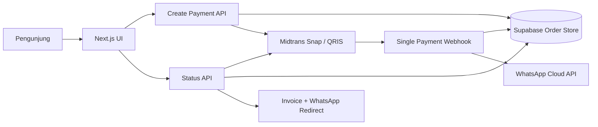

# Arsitektur Sistem — NALARA

## Pendekatan

Website memakai Next.js hybrid. Landing page dan checkout diprarender untuk performa, sedangkan pembuatan transaksi, pengecekan status, invoice dinamis, dan webhook berjalan sebagai serverless functions.

## Sumber harga

Paket dan nominal resmi disimpan di `lib/commerce.ts`. Browser hanya mengirim ID paket. Route create menetapkan sendiri harga Rp69.000; webhook dan status API kembali mencocokkan nominal Midtrans dengan order server-side.

## Penyimpanan order

Supabase menyimpan data invoice, status, token publik acak, Snap token, dan status pengiriman WhatsApp. RLS aktif tanpa policy publik; hanya Service Role Key pada server yang boleh mengakses tabel.

## Webhook tunggal

`/api/payments/webhook`:

1. Memverifikasi SHA-512 `signature_key` Midtrans.
2. Mengambil ulang status transaksi dari Midtrans.
3. Mencocokkan order ID dan nominal.
4. Memperbarui status order.
5. Mengklaim pengiriman secara atomik agar invoice WhatsApp tidak terkirim dua kali.
6. Mengirim template invoice melalui WhatsApp Cloud API.

## Deployment

Gunakan hosting Next.js serverless dengan environment secret. Detail setup berada di `DEPLOYMENT.md` dan `PAYMENTS_SETUP.md`.
