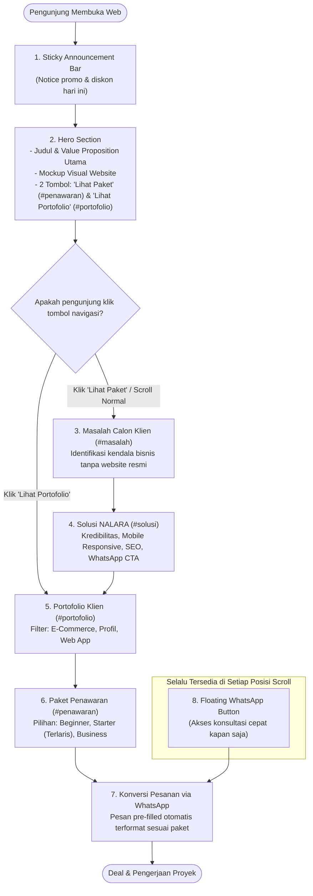

# Dokumentasi Proyek NALARA — Landing Page 1 Halaman

Dokumen ini berisi penjelasan lengkap mengenai arsitektur, teknologi, struktur kode, dan alur naratif (*user journey*) dari website **NALARA**—platform landing page berkonversi tinggi (*high-converting single-page website*) untuk jasa pembuatan website & digitalisasi bisnis.

---

## 1. 📌 Ikhtisar Proyek

**NALARA** adalah layanan digital profesional yang berfokus pada jasa pembuatan website, landing page, dan sistem web app untuk pelaku UMKM, bisnis rintisan, lembaga pendidikan, maupun profil profesional.

### Konsep Desain: Single-Page Architecture
Website ini sengaja dirancang sebagai **Single-Page Application (Landing Page 1 Halaman)** dengan tujuan:
- **Fokus Konversi Tinggi**: Menghilangkan distraksi perpindahan halaman agar pengunjung tetap berada di dalam corong (*funnel*) penjualan dari atas hingga bawah.
- **Storytelling Terstruktur**: Membimbing pola pikir calon klien dari kesadaran masalah (*problem awareness*), tawaran solusi (*solution*), bukti kredibilitas (*social proof*), paket harga (*pricing tier*), hingga penutupan transaksi (*action CTA*).
- **Kecepatan & Performa**: Tidak membutuhkan navigasi multi-halaman yang memuat ulang aset, memanfaatkan *smooth in-page anchor scrolling*.

---

## 2. 🛠️ Tech Stack & Ekosistem

| Lapisan | Teknologi | Penjelasan |
| :--- | :--- | :--- |
| **Framework** | Next.js 16 (App Router) | Mendukung SSR, turbopack compilation cepat, metadata SEO, dan rute API. |
| **Bahasa** | TypeScript 5 & React 19 | Menjamin type safety dan komponen UI modern dengan performa tinggi. |
| **Styling** | Tailwind CSS v4 & PostCSS | Sistem styling utilitas berbasis CSS variables untuk tema gelap (*Dark Theme*). |
| **Ikonografi** | Lucide React | Ikon SVG ringan dan konsisten di seluruh seksi web. |
| **Font & Typo** | Plus Jakarta Sans & Cal Sans | Tipografi modern yang kredibel dan mudah dibaca di layar mobile. |
| **Integrasi Kontak** | WhatsApp Cloud / Direct Wa.me | Corong transaksi instan dengan teks pesan terformat otomatis per paket. |
| **Opsi Checkout & Invoice** | Midtrans Snap & Supabase | Fondasi backend payment & status invoice jika diaktifkan untuk pembayaran digital. |

---

## 3. 📁 Struktur Direktori & File

Berikut peta file utama yang menyusun landing page:

```text
nalara/
├── app/
│   ├── globals.css              # Variabel tema warna dark, keyframes, scroll-behavior
│   ├── layout.tsx               # Root layout, metadata SEO global, viewport & OG tags
│   ├── page.tsx                 # Halaman utama "/" (LandingPage dengan nomor default NALARA)
│   ├── [slug]/                  # Dynamic route untuk halaman personal user (/ahmad-habibi)
│   │   └── page.tsx             # Server component: query cached user, render LandingPage dengan nomor user
│   ├── admin/                   # Panel manajemen admin
│   │   ├── (dashboard)/         # Route group dashboard admin
│   │   │   ├── layout.tsx       # Navbar admin & guard layout
│   │   │   └── page.tsx         # Manajemen mitra/user (tabel, search, form tambah, modal edit/hapus)
│   │   ├── login/page.tsx       # Halaman login admin berbasis Supabase Auth
│   │   ├── actions.ts           # Server Actions untuk mutasi data user (Zod + requireAdmin)
│   │   └── layout.tsx           # Layout root admin (metadata noindex, nofollow)
│   ├── checkout/page.tsx        # Redirect cepat ke corong WhatsApp (mendukung ?ref=slug)
│   ├── invoice/[token]/page.tsx # Halaman cetak/cek invoice pembayaran (opsional)
│   ├── robots.ts & sitemap.ts   # SEO indexing & sitemap generator (halaman user diexclude)
│   ├── api/track-cta/route.ts   # Endpoint telemetri klik CTA WhatsApp (Fase 6A, silent & rate-limited)
│   └── api/payments/            # Endpoint webhook & order payment (opsional)
├── components/
│   ├── brand-logo.tsx           # Komponen logo identitas NALARA
│   ├── contact-provider.tsx     # React Context penyedia whatsappNumber & refSlug ke seluruh komponen
│   ├── landing-page.tsx         # Komponen tunggal landing page (dipakai bersama oleh "/" dan "/[slug]")
│   ├── floating-whatsapp.tsx    # Tombol WhatsApp melayang (sticky di sudut kanan bawah)
│   ├── promo-price.tsx          # Komponen tampilan harga promo dinamis vs harga normal
│   ├── promo-timer.tsx          # Hook & countdown timer siklus promo otomatis
│   ├── section-heading.tsx      # Komponen standar judul seksi (eyebrow, title, description)
│   ├── admin/                   # Komponen khusus panel admin:
│   │   ├── copy-button.tsx      # Tombol salin tautan user ke clipboard
│   │   ├── delete-user-dialog.tsx # Dialog konfirmasi hapus permanen user
│   │   ├── edit-user-modal.tsx  # Modal edit nama, nomor telepon, dan custom slug
│   │   ├── new-user-form.tsx    # Form tambah user baru dengan live preview URL & link WA
│   │   ├── user-search.tsx      # Search bar debounce untuk filter daftar user
│   │   └── user-table.tsx       # Tabel daftar user (status aktif, toggle switch, aksi edit/hapus)
│   ├── sections/                # Seluruh blok seksi penyusun 1 halaman utama:
│   │   ├── announcement.tsx     # 1. Bar promo melayang di paling atas
│   │   ├── hero.tsx             # 2. Hero banner, value proposition & navigasi atas
│   │   ├── problems.tsx         # 3. Seksi masalah bisnis yang sering terjadi (#masalah)
│   │   ├── solutions.tsx        # 4. Seksi solusi & keunggulan NALARA (#solusi)
│   │   ├── client-work.tsx      # 5. Portofolio klien & filter kategori (#portofolio)
│   │   ├── offer.tsx            # 6. Paket penawaran harga & rincian fitur (#penawaran)
│   │   └── footer.tsx           # 7. Penutup halaman & tautan sosial media
│   └── ui/                      # Komponen primitif UI (Button, Badge, Card, Dialog)
├── lib/
│   ├── auth.ts                  # Helper requireAdmin() dan checkIsAdmin() (validasi sesi & tabel admins)
│   ├── commerce.ts              # Data paket (Beginner, Starter, Business), harga & fitur
│   ├── cta-tracking.ts          # Helper pengiriman beacon / keepalive klik CTA & validasi lokasi (Fase 6A)
│   ├── phone.ts                 # Normalisasi nomor telepon ke format WA standar Indonesia (628xxx)
│   ├── portfolio-data.ts        # Data proyek klien, kategori filter, URL demo & tags
│   ├── site-config.ts           # Konfigurasi nomor WA, generator getWhatsAppUrl(), link sosmed
│   ├── site-url.ts              # Resolusi domain utama untuk metadata canonical
│   ├── site-users.ts            # Data layer site_users dengan Next.js 16 Data Cache & on-demand revalidation
│   ├── slug.ts                  # Generator slugify(), getSlugCandidate() collision retry, reserved slugs
│   └── supabase/                # Inisialisasi Supabase client:
│       ├── client.ts            # Client browser untuk auth/login
│       ├── server.ts            # Server client dengan cookies() untuk server components & actions
│       └── public.ts            # Server client tanpa cookies untuk public cached data fetching
├── proxy.ts                     # Proxy/middleware Next.js 16 (proteksi rute /admin & session refresh)
├── supabase/
│   └── migrations/              # Berkas migrasi database SQL (site_users, admins, get_slug_status)
├── tests/                       # Unit test Vitest (phone, slug, retry collision, regression baseline)
└── docs/
    ├── document.md              # Dokumentasi teknis proyek ini
    ├── prd.md                   # PRD spesifikasi fitur user pages & admin
    ├── roadmap.md               # Rencana implementasi fase 0 - 5
    ├── audit.md                 # Baseline audit kode & pemetaan wa.me
    ├── rls-tests.md             # Panduan dan skrip pengujian RLS Supabase
    └── release-checklist.md     # Checklist rilis produksi & prosedur rollback
```

---

## 4. 🔄 Alur Web 1 Halaman (Narrative Flow & User Journey)

Karena website ini beroperasi dalam **1 halaman tunggal (`app/page.tsx`)**, urutan penempatan komponen disusun menggunakan formula psikologi konversi (*AIDA: Attention, Interest, Desire, Action*).

### Diagram Alur Pengunjung



---

### Detail Seksi per Seksi (Urutan Vertikal)

#### 1. `<Announcement />` (Sticky Top Bar)
- **Posisi**: Terpaku di bagian paling atas layar (`sticky top-0 z-50`).
- **Fungsi**: Menarik perhatian instan (*Attention hook*). Mengabarkan adanya promo aktif atau potongan harga untuk paket terlaris (*Starter*).
- **Interaksi**: Mengandung tautan cepat `href="#penawaran"` yang langsung menggulir halaman ke tabel harga.

#### 2. `<Hero />` (Header & Value Proposition Utama)
- **Komponen**:
  - **Navigasi Atas**: Logo brand NALARA, tautan profil Instagram, dan tombol "Konsultasi" ke WhatsApp.
  - **Headline & Subheadline**: Penegasan nilai utama: *"Tingkatkan kredibilitas bisnis Anda dengan website profesional."*
  - **Checklist Manfaat Cepat**: Desain responsif, domain .com & SSL gratis, garansi maintenance.
  - **2 Tombol CTA**:
    1. `Lihat Paket Mulai Rp...` -> Menggulir ke `#penawaran`.
    2. `Lihat Portofolio Klien` -> Menggulir ke `#portofolio`.
  - **Visual Mockup**: Card interaktif yang memperlihatkan preview profil bisnis, toko online, dan pemesanan WhatsApp.

#### 3. `<Problems />` (Membangun Kesadaran Masalah — `#masalah`)
- **Tujuan**: Menghadirkan rasa empati dan membangkitkan kesadaran (*Problem Awareness*) pada calon pelanggan:
  1. *Calon pembeli belum yakin* (tidak punya pusat informasi resmi).
  2. *Produk sulit ditemukan* (tenggelam di feed media sosial).
  3. *Pelanggan bingung alur pembelian*.
  4. *Kekhawatiran biaya website mahal*.

#### 4. `<Solutions />` (Jawaban & Keunggulan NALARA — `#solusi`)
- **Tujuan**: Memperkenalkan solusi praktis yang ditawarkan NALARA:
  - Tampilan elegan & modern.
  - Tampilan responsif di smartphone maupun komputer.
  - Tombol pemesanan langsung terintegrasi ke WhatsApp.
  - Optimasi SEO dasar agar terindeks Google.
  - Performa loading kilat tanpa beban kode berat.
  - Garansi maintenance dan domain .com resmi.

#### 5. `<ClientWork />` (Bukti Sosial / Portofolio — `#portofolio`)
- **Tujuan**: Membangun kepercayaan (*Social Proof*) dengan menunjukkan hasil karya nyata yang sudah live.
- **Fitur Interaktif**:
  - **Tab Kategori**: Filter instan tanpa refresh halaman (*Semua Proyek*, *Bisnis & E-Commerce*, *Profil & Lembaga*, *Sistem & Web App*).
  - **Kartu Proyek**: Dilengkapi domain aktif, deskripsi fitur, badge tag teknologi, dan tombol tautan langsung ke situs live.
  - **CTA Banner**: Kotak ajakan di bawah grid portofolio bagi klien yang menginginkan sistem kustom di luar daftar portofolio.

#### 6. `<Offer />` (Penawaran Paket & Harga — `#penawaran`)
- **Tujuan**: Mengarahkan pengunjung pada keputusan memilih paket layanan (*Value Ladder*):
  - **Paket Beginner**: Rp650.000 (Website statis 1 halaman, hosting standar, SSL, garansi 7 hari).
  - **Paket Starter** (*Paling Banyak Dipesan / Best Value*): Rp1.200.000 (Landing page komplit, domain .com gratis 1 tahun, email bisnis `xxx@bisnis.com`, hosting 1 tahun, garansi 15 hari).
  - **Paket Business**: Rp1.900.000 (Hingga 5 halaman, 2 email bisnis, penyimpanan 10 GB, revisi 5x, garansi 30 hari).
- **Tiap Paket Memiliki Tombol WhatsApp Sendiri**: Mengirim teks spesifik sesuai paket yang dipilih.

#### 7. `<Footer />` (Penutup & Identitas)
- **Tujuan**: Menutup halaman dengan rapi, menegaskan tagline brand (*"Solusi digital dengan nalar dan arah yang jelas"*), serta menyediakan tautan navigasi ke Instagram dan WhatsApp resmi.

#### 8. `<FloatingWhatsApp />` (Floating Action Button)
- **Tujuan**: Tombol hijau WhatsApp melayang di sudut kanan bawah (`fixed z-50`).
- **Fungsi**: Selalu terlihat di mana pun posisi scroll pengunjung, memberi kemudahan konsultasi instan tanpa perlu mencari tombol di atas atau bawah.

---

## 5. ⚙️ Fitur Kunci & Mekanisme Teknis

### A. Smooth Anchor Scrolling
Semua navigasi antar bagian menggunakan sistem hash link (`#masalah`, `#solusi`, `#portofolio`, `#penawaran`). Dikonfigurasi secara native di `app/layout.tsx` dan `globals.css`:
```css
html {
  scroll-behavior: smooth;
  overflow-x: clip;
}
```
Ketika pengunjung mengklik tombol *"Lihat Portofolio Klien"*, browser secara halus menggulirkan viewport tepat ke `<section id="portofolio">`.

### B. Dynamic Promo & Countdown System
File [`components/promo-timer.tsx`](file:///c:/Users/muhaz/OneDrive/Desktop/nalara/components/promo-timer.tsx) mengelola siklus waktu promo secara otomatis di browser pengunjung:
- **Siklus**: 60 menit fase promo + 10 menit fase jeda (disimpan di `localStorage` per browser).
- **Efek pada UI**: Komponen [`components/promo-price.tsx`](file:///c:/Users/muhaz/OneDrive/Desktop/nalara/components/promo-price.tsx) secara dinamis menampilkan harga coret saat fase promo dan label harga normal saat fase jeda.

### C. Pre-filled WhatsApp Conversion URLs
Diatur pada [`lib/site-config.ts`](file:///c:/Users/muhaz/OneDrive/Desktop/nalara/lib/site-config.ts). Setiap tombol pesanan memiliki tautan `wa.me` dengan pesan terformat otomatis:
- **Konsultasi Umum**: `Halo NALARA, saya ingin konsultasi paket pembuatan website...`
- **Pesan Starter**: `Halo NALARA, saya tertarik pesan Paket Starter (Rp1.200.000 - Paling Banyak Dipesan)...`
- **Pesan Business**: `Halo NALARA, saya tertarik pesan Paket Business (Rp1.900.000)...`

Calon pembeli tidak perlu mengetik dari awal, mengurangi hambatan (*friction*) dalam bertransaksi.

---

## 6. 📝 Panduan Pemeliharaan & Kustomisasi

### 1. Mengubah Nomor WhatsApp & Identitas Kontak
Buka file [`lib/site-config.ts`](file:///c:/Users/muhaz/OneDrive/Desktop/nalara/lib/site-config.ts):
```typescript
export const siteConfig = {
  name: "NALARA",
  tagline: "Solusi digital dengan nalar dan arah yang jelas.",
  whatsappNumber: "6289517795206", // Ganti dengan nomor WhatsApp aktif (awali 62 tanpa +)
  instagramHandle: "nalara.website", // Ganti dengan username IG
};
```

### 2. Mengubah / Menambah Proyek Portofolio
Buka file [`lib/portfolio-data.ts`](file:///c:/Users/muhaz/OneDrive/Desktop/nalara/lib/portfolio-data.ts):
Tambahkan objek baru ke dalam array `portfolioProjects`:
```typescript
{
  id: "nama-proyek-baru",
  title: "Judul Klien — Jenis Website",
  headline: "Deskripsi singkat hasil karya",
  description: "Penjelasan lengkap sistem yang dibangun...",
  url: "https://domainklien.com",
  domain: "domainklien.com",
  category: "ecommerce", // Pilihan: "ecommerce" | "profile" | "webapp"
  categoryLabel: "Toko Online",
  tags: ["Fitur 1", "Fitur 2", "Domain .com"],
  isFeatured: true,
}
```

### 3. Mengubah Harga dan Rincian Paket
Buka file [`lib/commerce.ts`](file:///c:/Users/muhaz/OneDrive/Desktop/nalara/lib/commerce.ts):
Ubah nilai `price`, `regularPrice`, atau daftar `features` pada `beginnerPackage`, `starterPackage`, atau `businessPackage`. Perubahan harga akan otomatis tercermin di seluruh bagian web.

---

## 7. 🚀 Panduan Menjalankan Proyek

### Mode Pengembangan (Local Dev)
```bash
npm run dev
```
Buka browser di `http://localhost:3000`.

### Pengecekan Type & Lint
```bash
npm run typecheck
npm run lint
```

### Build Produksi
```bash
npm run build
npm run start
```
Aplikasi siap dideploy ke Vercel, VPS, atau platform hosting modern lainnya.

---

## 8. 👥 Fitur User Pages & Multi-User WhatsApp Routing

### Konsep Utama
Fitur User Pages memungkinkan admin mendaftarkan mitra/tim penjualan hanya dengan memasukkan **Nama** dan **Nomor Telepon**.
- Setiap user otomatis mendapatkan URL personal: `https://domain.com/[slug]` (contoh: `https://domain.com/ahmad-habibi`).
- Tampilan landing page pada `/[slug]` **sama persis 100%** dengan halaman utama `/` (urutan seksi, teks penawaran, harga, portofolio, dan promo timer).
- **Satu-satunya perbedaan**: seluruh tombol CTA WhatsApp (hero, paket Beginner, Starter, Business, banner portofolio, footer, dan floating button) otomatis mengarah ke nomor WhatsApp milik user tersebut (`phone_wa` berformat `628xxx`).
- Jika pengunjung diarahkan ke `/checkout`, query param `?ref=[slug]` akan dipetakan ke nomor user yang bersangkutan sehingga atribusi lead tetap terjaga.

### Komponen Tunggal (Single Component Architecture)
Alih-alih menduplikasi komponen landing page, proyek menggunakan satu komponen bersama:
```tsx
// components/landing-page.tsx
<ContactProvider whatsappNumber={whatsappNumber} refSlug={refSlug}>
  <main>
    <Announcement />
    <Hero />
    ...
  </main>
</ContactProvider>
```
Komponen seksi membaca nomor WhatsApp aktif melalui custom hook:
```tsx
const { whatsappNumber } = useContact();
const waUrl = useWhatsAppUrl(); // Menghasilkan URL wa.me dengan nomor aktif
```

---

## 9. ⚡ Arsitektur Caching & Model Revalidasi Next.js 16

Halaman dinamis `/[slug]` dirancang agar memiliki LCP (*Largest Contentful Paint*) dan waktu muat setara dengan halaman statis `/`.

### Model Data Cache
1. **Pemisahan Client Publik**:
   Query data publik `getActiveUserBySlug` dan `getSlugStatus` menggunakan `createPublicClient()` (tanpa pemanggilan `cookies()`). Hal ini memungkinkan Next.js 16 menyimpan hasil query ke dalam **Data Cache**.
2. **Namespace Cache Key yang Terisolasi**:
   Fungsi dibungkus dengan `unstable_cache`:
   ```ts
   unstable_cache(
     async () => fetchActiveUserFromDb(slug),
     [`site-user-by-slug-${slug}`],
     {
       revalidate: 60, // TTL fallback: paling lambat 1 menit
       tags: ['site-users', `site-user-${slug}`]
     }
   )
   ```
   - **Mencegah Kebocoran Cache**: Cache key selalu memuat slug spesifik. Halaman `/ahmad-habibi` tidak akan pernah membaca atau tertukar dengan cache milik `/budi-santoso`.
3. **Revalidasi On-Demand Instan**:
   Setiap kali admin melakukan mutasi data via Server Actions (`createUserAction`, `updateUserAction`, `toggleUserActiveAction`, `deleteUserAction`), sistem langsung mengeksekusi:
   ```ts
   revalidateTag(`site-user-${slug}`, { expire: 0 });
   revalidateTag('site-users', { expire: 0 });
   revalidatePath(`/${slug}`);
   revalidatePath('/admin');
   ```
   Perubahan langsung tampil ke pengunjung publik saat request berikutnya tanpa menunggu TTL 60 detik.

---

## 10. 🔐 Cara Menambah Admin Baru

Akses ke dashboard `/admin` dilindungi oleh **Row Level Security (RLS)** dan tabel `public.admins`.

### Langkah Menambahkan Admin
1. Buka **Supabase Dashboard** proyek Anda.
2. Masuk ke menu **Authentication → Users**.
3. Buat user baru dengan mengklik **Add User → Create User** (masukkan email dan password admin).
4. Salin `User UID` yang baru dibuat (format UUID, misal: `a1b2c3d4-e5f6-7a8b-9c0d-1e2f3a4b5c6d`).
5. Buka menu **SQL Editor**, lalu jalankan query:
   ```sql
   INSERT INTO public.admins (user_id)
   VALUES ('a1b2c3d4-e5f6-7a8b-9c0d-1e2f3a4b5c6d');
   ```
6. Admin baru sekarang dapat login di `https://domain.com/admin/login` dan memiliki izin penuh untuk mengelola user.

---

## 11. 🔑 Daftar Lengkap Variabel Lingkungan (Environment Variables)

| Variabel | Lingkungan | Wajib? | Keterangan & Keamanan |
| :--- | :--- | :--- | :--- |
| `NEXT_PUBLIC_SITE_URL` | Client & Server | Ya | URL kanonikal situs (mis. `https://nalara.id` atau `http://localhost:3000`). |
| `NEXT_PUBLIC_SUPABASE_URL` | Client & Server | Ya | URL project Supabase (`https://<project-ref>.supabase.co`). |
| `NEXT_PUBLIC_SUPABASE_ANON_KEY` | Client & Server | Ya | Anon public key Supabase. Dilindungi RLS. |
| `SUPABASE_SERVICE_ROLE_KEY` | **Server Saja** | Opsional | **RAHASIA**. Jangan gunakan prefix `NEXT_PUBLIC_`. Hanya dipakai untuk background job pembayaran. |
| `MIDTRANS_SERVER_KEY` | Server Saja | Opsional | Kunci server pembayaran Midtrans jika invoice diaktifkan. |
| `NEXT_PUBLIC_MIDTRANS_CLIENT_KEY` | Client Saja | Opsional | Kunci client Snap Midtrans. |

---

## 12. 🩺 Panduan Troubleshooting Singkat

### A. Slug Tidak Ketemu (Error 404)
- **Penyebab**: Slug salah ketik atau belum terdaftar di tabel `site_users`.
- **Solusi**: Cek daftar user di `/admin`. Pastikan slug yang dicari ada di tabel. Perhatikan bahwa slug bersifat case-insensitive (huruf kapital akan otomatis di-redirect ke huruf kecil).

### B. User Nonaktif Di-redirect ke Halaman Utama "/"
- **Penyebab**: Status user diatur `Nonaktif` (`is_active = false`) oleh admin.
- **Solusi**: Buka `/admin`, cari nama user, dan geser toggle switch ke status `Aktif`.

### C. Nomor WhatsApp Salah atau Muncul Peringatan di Form
- **Penyebab**: Format nomor yang dimasukkan bukan format nomor ponsel Indonesia.
- **Solusi**: Sistem otomatis menormalisasi nomor yang diawali `08`, `+628`, `628`, atau `8` dengan panjang 9–14 digit. Pastikan nomor diawali angka `8` dan tidak mengandung karakter non-digit selain `+` di awal.

### D. Perubahan Data Belum Tampil di Halaman Publik
- **Penyebab**: Cache browser lokal atau CDN proxy.
- **Solusi**: Sistem telah dilengkapi revalidasi on-demand instan (`revalidateTag` & `revalidatePath`) dan TTL maksimum 60 detik. Lakukan hard refresh di browser (`Ctrl + Shift + R` atau `Cmd + Shift + R`) atau tunggu maksimum 60 detik.

---

## 13. 📊 Arsitektur Telemetri & Tracking Klik CTA (Fase 6A)

### A. Alur Kerja
1. Pengunjung mengklik salah satu tombol CTA WhatsApp di landing page (`/` atau `/[slug]`).
2. Browser mengeksekusi tautan `wa.me` secara langsung tanpa jeda, sekaligus memanggil `trackCtaClick()` secara asinkron.
3. Payload dikirim melalui `navigator.sendBeacon` (atau `fetch` dengan header `keepalive: true` sebagai fallback) ke endpoint `POST /api/track-cta`.
4. Endpoint memvalidasi data menggunakan Zod, menerapkan sliding-window in-memory rate limiting & dedupe, meresolusi `user_id` dari `slug` (menggunakan cached lookup), lalu menyimpan data ke tabel `cta_clicks` via Supabase client publik (`anon`).
5. Respons endpoint selalu `204 No Content` dan seluruh error ditangani secara senyap tanpa mengganggu pengunjung.

### B. Identifier Lokasi CTA Resmi
| Identifier | Lokasi Komponen | Keterangan |
| :--- | :--- | :--- |
| `hero` | `components/sections/hero.tsx` | Tombol Konsultasi pada navigasi atas / hero |
| `offer-beginner` | `components/sections/offer.tsx` | Tombol pesan paket Beginner |
| `offer-starter` | `components/sections/offer.tsx` | Tombol pesan paket Starter (Paling Banyak Dipesan) |
| `offer-business` | `components/sections/offer.tsx` | Tombol pesan paket Business |
| `floating` | `components/floating-whatsapp.tsx` | Tombol WhatsApp mengambang di pojok layar |
| `footer` | `components/sections/footer.tsx` | Tautan WhatsApp resmi di footer |
| `portfolio-banner` | `components/sections/client-work.tsx` | Tombol konsultasi pada kartu banner penutup portofolio |

### C. Keamanan & Privasi
- Tidak ada penyimpanan IP address, browser fingerprint, atau data pribadi pengunjung.
- Tabel `cta_clicks` dilindungi RLS: publik (`anon`) hanya diizinkan `INSERT`, sedangkan `SELECT` hanya untuk akun yang terdaftar di tabel `admins`.
- Dashboard admin menampilkan ringkasan performa: total klik CTA, klik 7 hari terakhir, dan kolom "Klik (7h / Total)" per pengguna.


